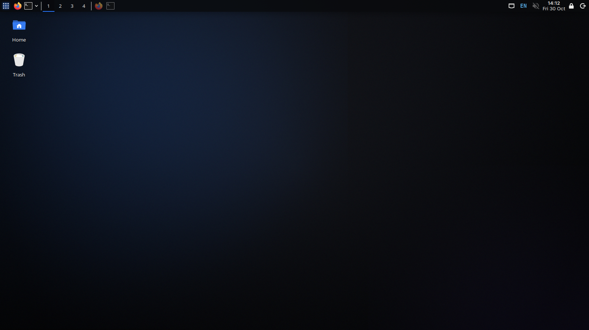
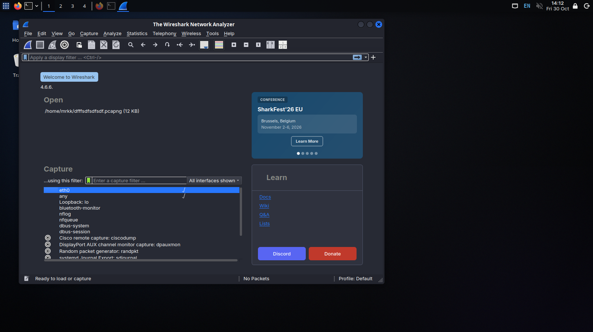

# Netwalks Internship

This repository documents my tasks and progress during the Netwalks internship.

## Week 1 — Completed ✅

I have successfully installed Kali Linux and completed my Week 1 task for the Netwalks internship.

### 1. Kali Linux

Kali Linux is installed and ready to use.

### 2. Wireshark

Wireshark is set up and running on Kali Linux.

